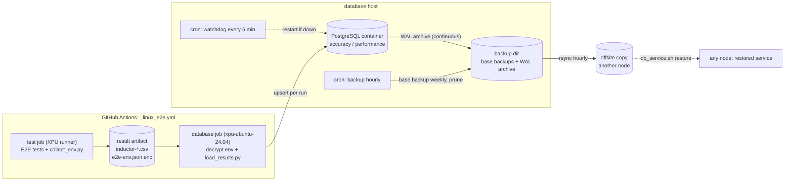
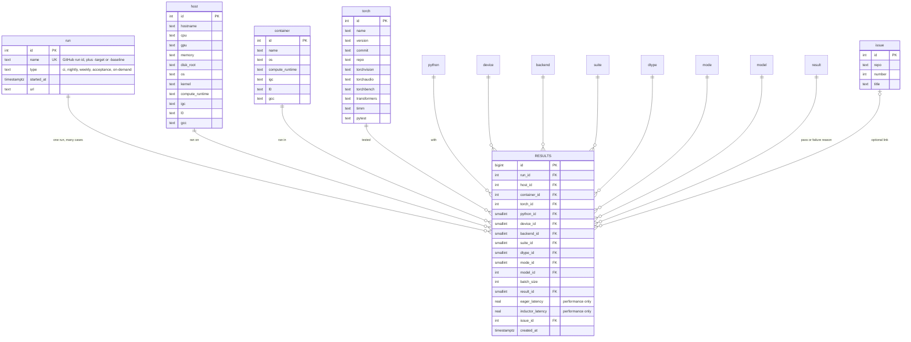

# E2E results database

Stores every E2E inductor run (CI, nightly, weekly, acceptance, on-demand) in PostgreSQL so runs
can be compared later (CI vs. nightly, nightly vs. previous nightly, weekly vs. previous weekly,
on-demand vs. latest weekly) and E2E summary reports can query history.

| File | Purpose |
| --- | --- |
| `db_service.sh` | Database service on the database host: start, keep alive, back up, restore |
| `schema/common.sql` | Lookup tables shared by both databases |
| `schema/accuracy.sql`, `schema/performance.sql` | Main result table and readable view per database |
| `collect_env.py` | Writes the test-environment JSON in the test environment |
| `load_results.py` | Loads `inductor-*.csv` results plus the environment JSON into the databases |

## Data infrastructure



## Data model

There are two databases, `accuracy` and `performance`, with the same layout; rows are routed by
the CSV `scenario` column. Lookup tables store each value once, so main tables only hold small
integer ids and stay fast as they grow.



`RESULTS` is the `accuracy` table in the `accuracy` database and the `performance` table in the
`performance` database. `device`, `backend`, `suite`, `dtype`, `mode`, `model`, `result` and
`python` are `(id, name)` lookups.

- `run`: one row per test run; all shards of a run share it. `type` + `started_at` find the
  latest or previous run of a kind.
- `host`, `container`, `torch`, `python`: the environment. A new row is created only when a field
  changes (e.g. a driver upgrade), so environment changes show up per run.
- Each case is unique per `(run, device, backend, suite, dtype, mode, model)`; re-loading a run
  updates rows instead of duplicating them. That index serves run-vs-run comparisons, and
  `(suite, dtype, mode, model, run)` serves the history of one case.
- Performance latencies are NULL for failed cases; `result` keeps the failure reason. Speedup is
  `eager_latency / inductor_latency`.
- Views `v_accuracy` / `v_performance` join everything into readable rows.

## Start the database service

On the database host (Docker required, user in the `docker` group, Docker enabled at boot):

```bash
cd .github/scripts/e2e_db
./db_service.sh start
```

`start` is idempotent and also used for upgrades:

1. Creates `${E2E_DB_DIR:-$HOME/e2e-db}` with `pgdata/`, `backup/` and `postgres.env` (random
   password, readable by the owner only) on first use.
2. (Re)creates the PostgreSQL container with `--restart always`, a health check and continuous WAL
   archiving, running as the host user so backup files are readable. Data stays in `pgdata/`.
3. Creates the `accuracy` and `performance` databases and applies the schema (only adds tables,
   columns, indexes and views, so re-running is safe).
4. Installs cron jobs: `watchdog` every 5 minutes and `backup` hourly.
5. Takes the first base backup.

Settings are environment variables; `start` saves them to `$E2E_DB_DIR/service.env` for cron:

| Variable | Default | Meaning |
| --- | --- | --- |
| `E2E_DB_DIR` | `$HOME/e2e-db` | Service directory |
| `E2E_DB_PORT` | `5432` | Published port |
| `E2E_DB_IMAGE` | `postgres:16` | PostgreSQL image |
| `E2E_DB_BACKUP_DIR` | `$E2E_DB_DIR/backup` | Local backup directory |
| `E2E_DB_BACKUP_REMOTE` | (empty) | rsync target for the offsite copy, e.g. `user@node:/path` |
| `E2E_DB_BASE_DAYS` | `7` | Days between full base backups |
| `E2E_DB_RETENTION_DAYS` | `90` | Maximum age of backup data (base backups and WAL) |
| `E2E_DB_DATA_DAYS` | `180` | Maximum age of results in the `accuracy` / `performance` tables |

`./db_service.sh status` shows container health, WAL archiving state and backup size.

Commands share a lock, so cron jobs skip while `start` or `restore` is running. The service and
backup directories must be dedicated absolute paths (not `/`, `$HOME`, `/home`, ...) and
`E2E_DB_BACKUP_REMOTE` must be `host:/absolute/path` or a dedicated local path, because `start`
changes ownership recursively and the offsite sync mirrors with `--delete`.

### Data retention

The main tables keep results for at most `E2E_DB_DATA_DAYS` (6 months). Every hourly `backup`
first deletes the `accuracy` / `performance` rows of runs whose `started_at` is older than that,
then the `run` rows left without results; `./db_service.sh purge` does the same on demand.
Environment and name lookups are small and kept.

### Keep alive

- Docker restarts the container after crashes and host reboots (`--restart always`).
- `watchdog` (cron, every 5 minutes) restarts the container when it is stopped or unhealthy and
  recreates the whole service when the container is gone. Actions are logged to
  `$E2E_DB_DIR/service.log`.

### Incremental backup

- PostgreSQL archives every completed WAL segment (compressed) to `backup/wal/` as it is written,
  so the backup grows incrementally with the data.
- `backup` (cron, hourly) closes the current WAL segment and waits until it is archived, so at
  most about an hour of writes is unarchived, takes a full base backup every `E2E_DB_BASE_DAYS`
  days, and mirrors `backup/` to `E2E_DB_BACKUP_REMOTE`.
- Retention: backups are kept for at most `E2E_DB_RETENTION_DAYS` (3 months). Older base
  backups and the WAL before the oldest remaining base backup are deleted, locally and (through
  the mirror) offsite, so any point in the last 3 months can be restored. The newest base backup
  is never deleted.
- `backup/` also holds a copy of `postgres.env`, so a restored node keeps the same credentials.

Set `E2E_DB_BACKUP_REMOTE` (with key-based SSH from the database host) so the backup survives the
loss of the host.

### Recover on another node

```bash
# On the new node, with this directory checked out:
rsync -a user@backup-node:/path/to/backup/ ~/e2e-db-backup/
./db_service.sh restore ~/e2e-db-backup
```

`restore` extracts the newest base backup into an empty `$E2E_DB_DIR/pgdata`, replays all archived
WAL, promotes the server and then runs `start` (cron, archiving and backups continue into the
given backup directory). Afterwards point the `E2E_DB_HOST` secret at the new node.

## Save data

### From CI

`.github/workflows/_linux_e2e.yml`:

1. The `test` job runs `collect_env.py` after the tests. The JSON is encrypted with
   `E2E_DB_PASSWORD` and added to the public result artifact as `e2e-env.json.enc`.
2. The `database` job on `xpu-ubuntu-24.04` downloads the artifact, decrypts the environment and
   runs `load_results.py`. It is non-blocking and skips when the secrets are unavailable (e.g.
   pull requests from forks).

Run type comes from the workflow `test_type`; the run name is the GitHub run id (plus `-target` /
`-baseline` for acceptance).

Required repository secrets: `E2E_DB_HOST` and `E2E_DB_PASSWORD` (`POSTGRES_PASSWORD` from
`postgres.env`). The loader never prints connection details or database error text because CI
logs are public.

### Manually

```bash
python collect_env.py --output env.json            # in the test environment
E2E_DB_HOST=<host> E2E_DB_PASSWORD=<password> \
python load_results.py --run <name> --run-type nightly \
    --meta env.json --input <dir with inductor-*.csv> [--started-at <ISO 8601>] [--run-url <url>]
```

Optional: `E2E_DB_PORT` (5432), `E2E_DB_USER` (`e2e`).

## Example: latest nightly vs. previous nightly

```sql
WITH n AS (
    SELECT id, row_number() OVER (ORDER BY started_at DESC) AS rn FROM run WHERE type = 'nightly'
)
SELECT s.name AS suite, d.name AS dtype, m.name AS mode, mo.name AS model,
       rb.name AS baseline, rt.name AS target
FROM accuracy t
JOIN accuracy b USING (device_id, backend_id, suite_id, dtype_id, mode_id, model_id)
JOIN suite s ON s.id = t.suite_id
JOIN dtype d ON d.id = t.dtype_id
JOIN mode m ON m.id = t.mode_id
JOIN model mo ON mo.id = t.model_id
LEFT JOIN result rt ON rt.id = t.result_id
LEFT JOIN result rb ON rb.id = b.result_id
WHERE t.run_id = (SELECT id FROM n WHERE rn = 1)
  AND b.run_id = (SELECT id FROM n WHERE rn = 2)
  AND rt.name IS DISTINCT FROM rb.name;
```

To compare other runs, pick the two run ids from `run` by `type` and `started_at` (or by `name`).

## Limitations

- Inside a container only the root disk is visible, and the user-space driver stack belongs to the
  image, so those fields go to `container` and the host's disk and driver fields stay NULL.
- PT2E quantization variants (symm/asymm) of the same model share one case key, so the last loaded
  variant wins.
