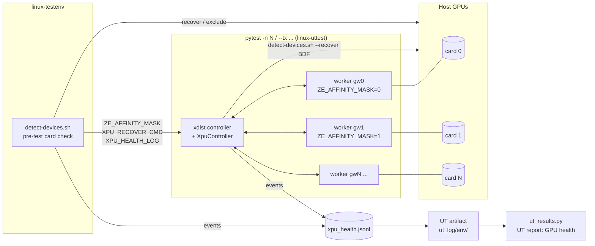
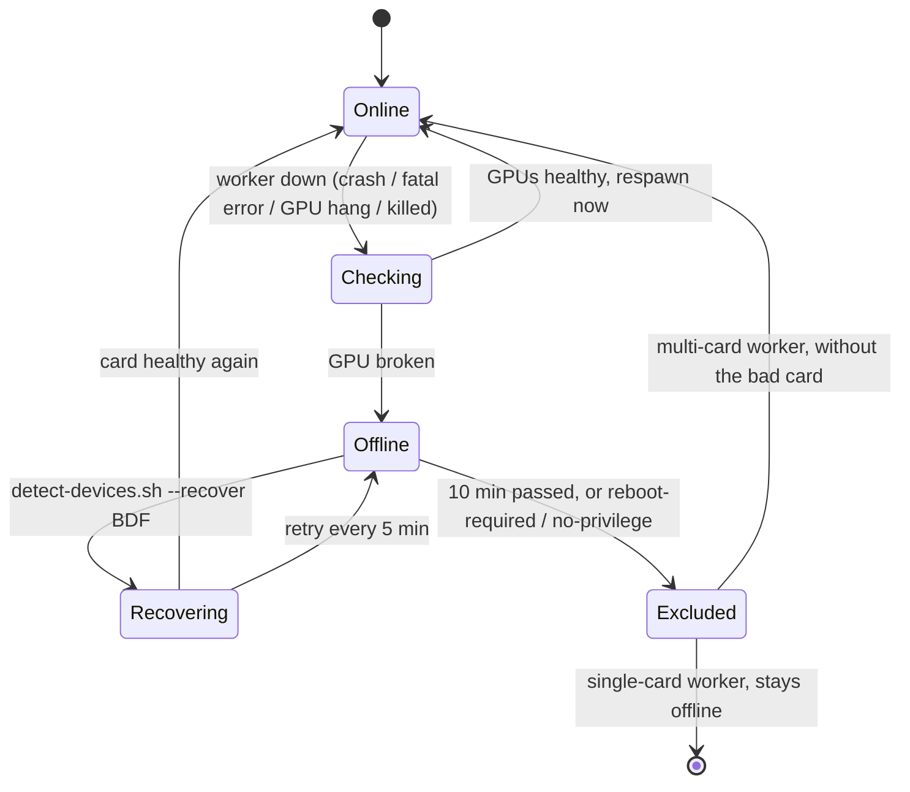
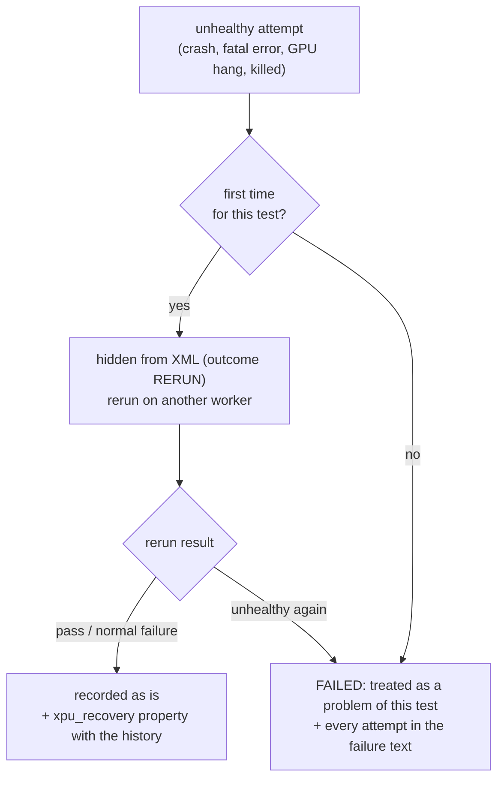
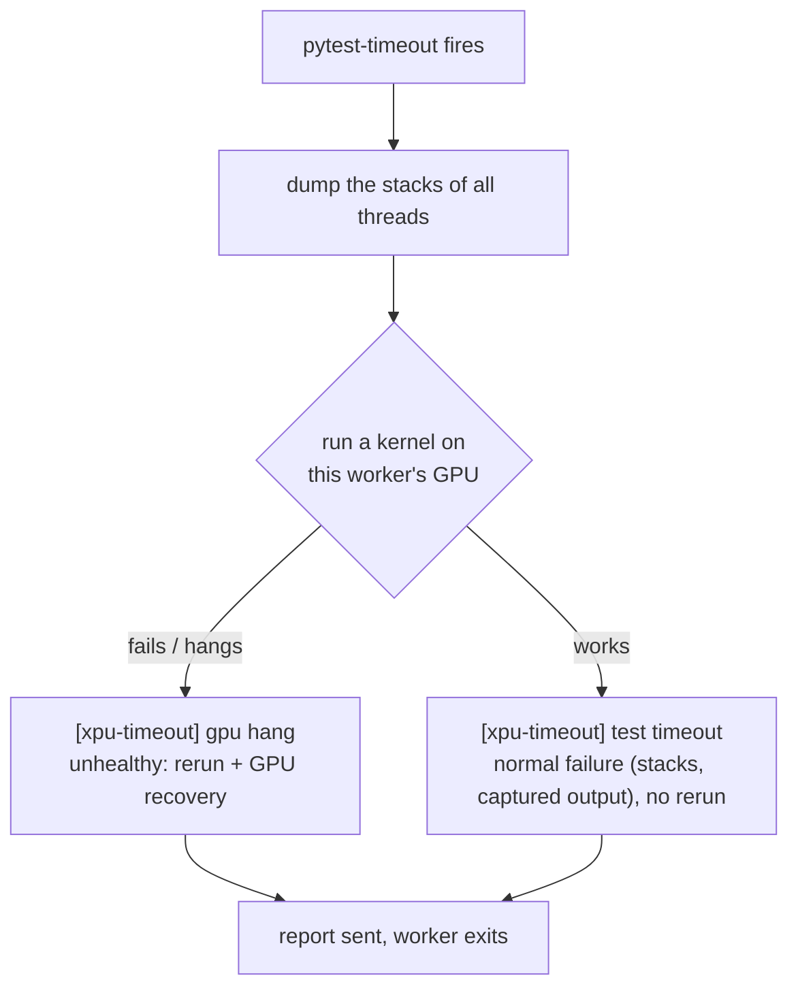
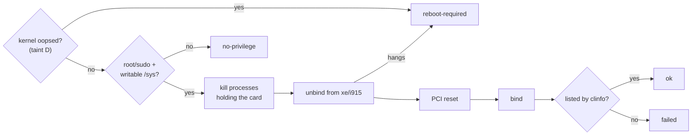

# pytest-xpu-worker-restart

A tiny [pytest-xdist](https://pypi.org/project/pytest-xdist/) plugin that restarts
an XPU worker process when a fatal failure is detected (device crash, out of
memory, segmentation fault, `ur_result_error`, etc.).

When such a failure is seen in a test report, the plugin:

1. Attempts to clean up the XPU device (`gc.collect()`, `torch.xpu.synchronize()`,
   `torch.xpu.empty_cache()`).
2. Forwards the real failure report to the xdist controller.
3. Forcibly exits the worker with code `101` so xdist respawns a fresh worker.

## Install

```bash
pip install .
```

Or, for development:

```bash
pip install -e .
```

## Usage

No configuration needed. Once installed, the plugin is auto-registered via its
`pytest11` entry point and activates automatically when running under xdist
(`pytest -n <N> ...`). This replaces the previous `conftest.py` +
`PYTHONPATH=.github/scripts/pytest_config` approach.

To disable it for a run:

```bash
pytest -p no:xpu_worker_restart ...
```

## GPU recovery (xdist controller)

A hung or lost GPU used to stall a run, or keep crashing every worker that
xdist respawned on it. With this plugin a run keeps going, the results stay
accurate, and broken cards are recovered or set aside.

### What it does

| Situation | Action |
|---|---|
| Worker crashes, hits a fatal XPU error, or its GPU hangs | Test is **rerun once on another worker**; the worker's GPUs are checked before it is respawned |
| Worker's GPU is broken | Worker goes **offline**, the card is **recovered**, the worker comes back **online** |
| Card not back within 10 min, or not recoverable | Card is **excluded**; remaining tests run on the other GPUs |
| pytest-timeout fires, GPU still works | **Real timeout**: normal failure with stacks in the XML, no rerun |
| Test is unhealthy again on its rerun | Reported as a **problem of the test**, with every attempt in the XML |

### Architecture



| Piece | Where | Role |
|---|---|---|
| `plugin.py` | every pytest process | options; on workers: restart on fatal errors, classify pytest-timeout |
| `controller.py` | xdist controller | worker lifecycle, reruns, watchdog, JUnit XML accuracy |
| `gpu.py` | controller and workers | card discovery (`clinfo`), GPU probe, recovery call, health events |
| [`detect-devices.sh`](../detect-devices.sh) | CI setup step | pre-test card check, `--recover <BDF>`, exports the env vars above |
| [`ut_results.py`](../ut_results.py) | UT report job | renders the GPU health events |

### Worker lifecycle

Each xdist worker is pinned to one or more GPUs (a *slot*: card PCI address +
tile). When a worker goes down, its slot is checked before it comes back:



- **Health check**: the card is still listed by `clinfo`, and a small kernel
  runs on every device of the slot.
- **While offline**, the other workers keep taking tests. The offline worker
  keeps the run alive only while tests are left.
- **Distributed runs** use `-n 1` with all cards in one worker: a bad card is
  excluded and the worker continues on the others.
- **Mask remap**: `ZE_AFFINITY_MASK` indexes cards in PCI order, so a lost card
  shifts every later index. Slots remember their cards by PCI address and get a
  recomputed mask when respawned.

### Rerun and result accuracy



The JUnit XML keeps exactly one entry per test: no empty `<testcase>` for the
rerun attempt and no FAILED+PASSED pair for the same test. A failure after
reruns explains itself:

```text
[xpu-recovery] 2 unhealthy run(s), rerun limit 1: treated as a problem of this test
  attempt 1: worker gw4 on 0000:19:00.0 (ZE_AFFINITY_MASK=0): fatal error in call: RuntimeError: UR_RESULT_ERROR_DEVICE_LOST; GPU healthy afterwards
  attempt 2: worker gw5 on 0000:1d:00.0 (ZE_AFFINITY_MASK=1): fatal error in call: RuntimeError: UR_RESULT_ERROR_DEVICE_LOST; GPU check pending
```

This replaces pytest-rerunfailures' crash reruns
(`--only-rerun crashed.*while.*running`), which are disabled while the plugin is
active; normal-failure reruns are untouched.

### Timeouts: GPU hang or slow test?

With `--timeout_method=thread`, the worker handles pytest-timeout itself:



A worker that cannot even run this (stuck in the GPU driver holding the GIL) is
killed by the controller's watchdog after `--timeout + 300` s and handled as a
hang. If it cannot be killed, it is dropped and the run moves on.

### Card recovery

`detect-devices.sh --recover <BDF>` prints `RESULT <status> <detail>`:



- Sysfs writes run in the background with a timeout, so a driver stuck in the
  kernel cannot hang CI; that case is `reboot-required`.
- `reboot-required` and `no-privilege` are final: the card is excluded right away
  instead of waiting 10 minutes.
- Bare-metal jobs have the needed rights (passwordless sudo); the UT container
  runs `--privileged` for it.

Before the tests, `detect-devices.sh` compares the Intel GPUs on PCI with what
the compute runtime lists, recovers the missing ones, and leaves those it cannot
recover out of `ZE_AFFINITY_MASK`.

### GPU health in the UT report

`detect-devices.sh` and the plugin append events to `$XPU_HEALTH_LOG`;
`linux-uttest` copies it into the UT artifact (`ut_log/env/xpu_health.jsonl`) and
the UT report shows it:

| Machine | Card | Event | UT job | Detail |
|---|---|---|---|---|
| runner-01 | 0000:19:00.0 | unhealthy | upstream_distributed | on PCI but not enumerated by the compute runtime |
| runner-01 | 0000:19:00.0 | reboot-required | upstream_distributed | kernel oopsed (taint D): unbinding 0000:19:00.0 would hang, reboot the node |
| runner-01 | 0000:19:00.0 | excluded | upstream_distributed | not usable before the tests started |

Events: `unhealthy`, `recovered`, `excluded`, `reboot-required`, `no-privilege`,
`failed`.

### Options

| Option | Default | |
|---|---|---|
| `--xpu-crash-reruns N` | 1 | reruns of an unhealthy test, 0 disables |
| `--xpu-hang-timeout S` | `--timeout` + 300 | kill a worker stuck this long, 0 disables |
| `--xpu-offline-timeout S` | 600 | how long a broken card may take to recover before it is excluded |
| `--xpu-recover-cmd CMD` | `$XPU_RECOVER_CMD` | command run with a card's PCI BDF to recover it |

Every step is logged with an `[xpu-recovery]` prefix. GPU checks turn off by
themselves on a machine without a usable XPU, and only apply under xdist.
